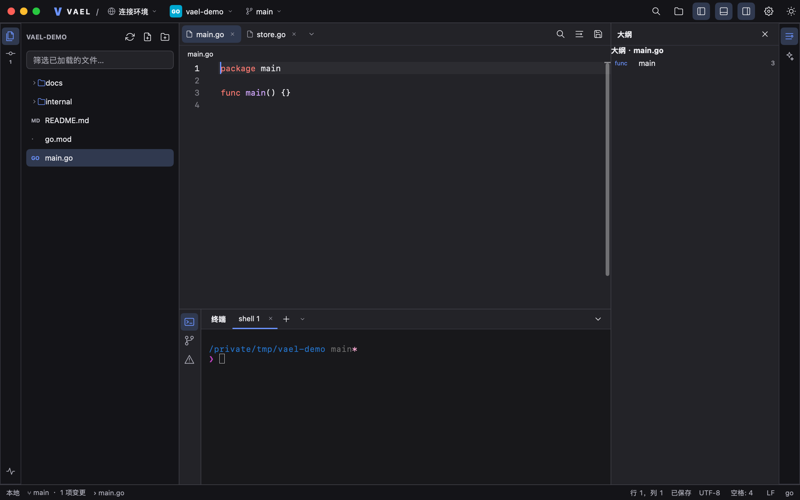
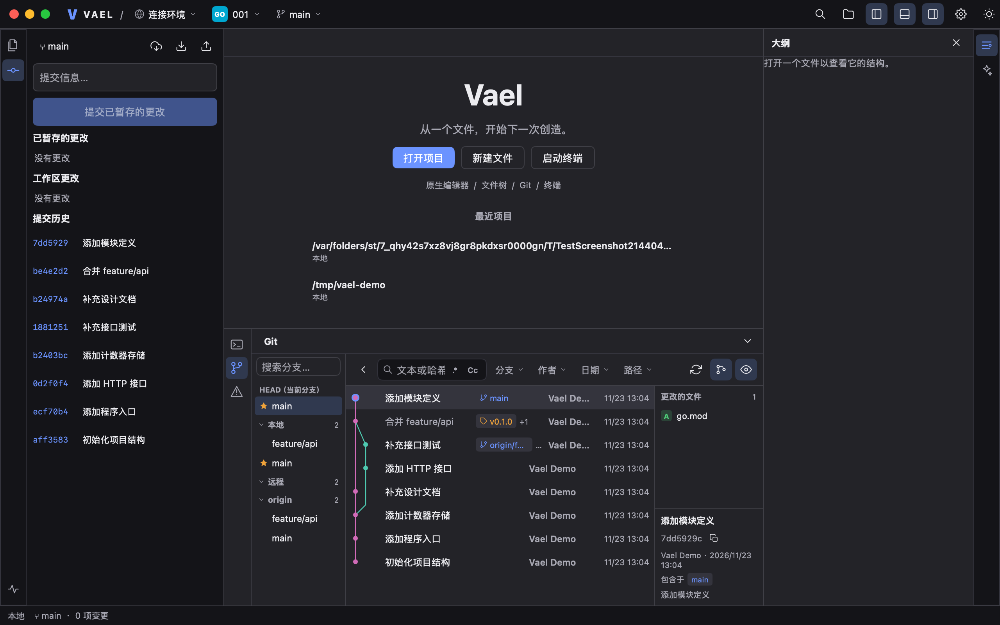
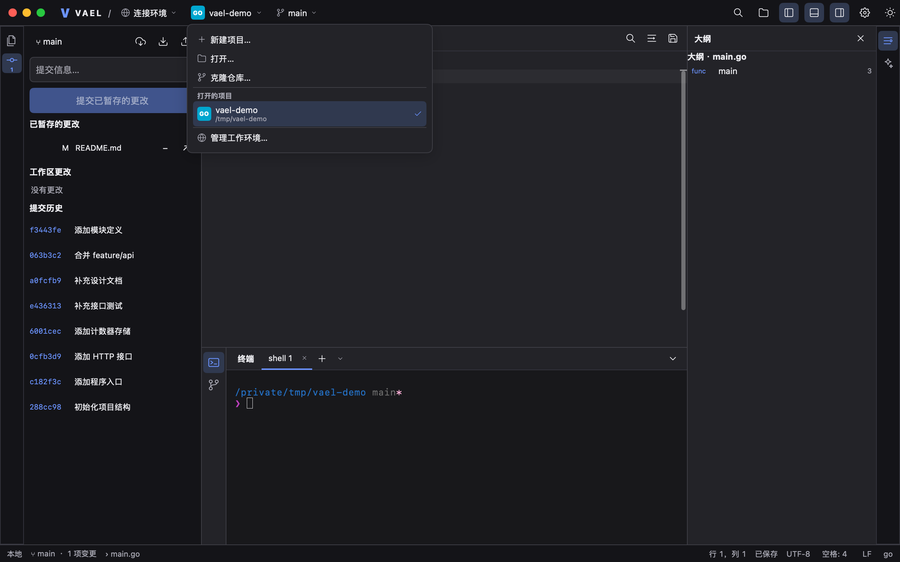
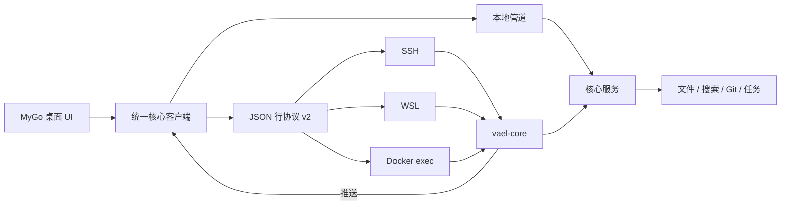

# Vael

**基于 Go + [MyGo](https://github.com/egoist/mygo) 原生 UI 的代码编辑器。** 布局参考 Lapce、Zed，配色参考 [GoShell](https://github.com/tk103331/goshell)。UI 与核心分两层：核心可以在本地，也可以经 SSH、WSL 或 Docker 跑在远端，两边用同一套协议。

[](https://github.com/tk103331/vael/actions/workflows/ci.yml)
[](LICENSE)



| Git 日志 | 项目与分支切换器 |
| --- | --- |
|  |  |

## 启动

需要 Go 1.27+、Git 与 MyGo 支持的桌面环境（Go 会自动下载项目声明的工具链）。

```sh
go run . /path/to/project   # 注意是 go run .，不是 go run main.go
```

不传路径时恢复上次的项目与布局。应用内可以切换本地文件夹、连接 SSH／WSL／Docker，或把文件夹直接拖到窗口上。

```sh
go tool mygo dev     # 开发
go tool mygo build   # 打包
```

终端使用 Ghostty 的 `libghostty-vt`，首次运行会下载运行库。

## 功能

- **编辑**：多标签（GoShell 风格）、语法高亮、折叠、查找替换、转到行／定义、自动换行、Git 变更行标；命令面板、快速打开、大纲、项目符号、项目全文搜索与全部替换。
- **文件**：按需加载的树、类型徽标、Git 状态着色、名字过长可横向滚动、右键新建／重命名／复制／删除；保存前检查磁盘冲突，磁盘变更自动重载。
- **Git**：分支切换器（搜索、最近／本地／远程、上游与领先落后）、暂存与提交、分栏差异、提交历史；**Git 日志**为三栏——分支面板、提交图与列表、更改的文件与详情，提交图按 GoShell 的车道算法绘制、用 IDEA 式斜线连接相邻提交，筛选支持正则与大小写。
- **语言服务器（LSP）**：Go（gopls）、TypeScript、Rust、Python、C、Lua 的服务器**在项目所在的机器上运行**——远端项目就在远端启动。提供诊断（编辑器内下划线 + 状态栏计数）、补全、悬停、转到定义（优先于内置符号索引）与格式化（`⌘/Ctrl+Shift+I`）；设置里可逐个启用并改启动命令，保存在 `lsp.json`。左侧图标栏底部有一个状态按钮（问题数为徽标），点击在浮窗里看每个服务器在运行／启动中／出错／已关闭的状态与问题数，点一行即可进入设置。
- **问题面板**（底部）：语言服务器报的诊断按文件分组列出（严重度标记、消息、来源与行列），左侧竖条的图标带问题数徽标，点一条即跳到文件里对应的位置。
- **终端与任务**：多会话真实 PTY；任务输出实时流式显示，可停止、可发送到终端。
- **Agent**：通过 **ACP（Agent Client Protocol）** 接入，可从 ACP Registry 或手动命令添加；流式回答与思考、工具调用状态、**工具审批**（含「总是允许」）、Agent 的计划显示为任务清单、`input_required` 提示追问。
- **窗口**：自绘标题栏（macOS 交通灯／Windows 与 Linux 窗口按钮）；标题栏依次是**环境**、**项目**、**分支**三个切换器；四区布局——左侧「文件」「Commit」，右侧「大纲」「Agent」，底部「终端」「Git 日志」「问题」（只在两侧面板之间）；面包屑、状态栏、专注模式、会话恢复。
- **连接**：SSH（自动探测平台并上传核心）、WSL、Docker；命名保存配置、最近 20 个项目、断线自动重连（保留缓冲区与终端）。
- **设置**：固定高度的窗口，左侧纵向分区、右侧内容（参考 IDEA 的 Preferences），内容超过窗口高度时自己滚动——外观（**界面主题** 8 套、**图标主题** 2 套、**字体**（系统等宽字体，可搜索）、字号、行高）、编辑器（换行、Tab 宽度、缩进、空白、参考线、自动闭合、行号；**自动保存**时机、保存时去行尾空格／补末尾换行／格式化）、环境（远程环境管理）、语言服务器（逐个启用、改启动命令）、ACP Agent。
- **保存**：自动保存（关闭／切换文件时／停顿一秒后）、保存时去掉行尾空格、保存时补上末尾换行、保存时格式化（先让语言服务器格式化再写盘），四项在「编辑器」分栏里。
- **代码**：`F2` 重命名符号（经语言服务器，改掉它写到的每一处；没有服务器时退回重命名文件）；快速打开支持 `文件名:行号`，直接跳到那一行。
- **字体**：编辑器、差异视图与终端的字体可选系统里的等宽字体（列表可搜索，「默认等宽」是 `monospace`），与字号一起随会话保留。
- **主题**：界面主题 Vael 深色／浅色、One Dark、Nord、Solarized 深浅、GitHub 深浅，各自带配色小样；图标主题有「文字徽标」（GO／TS／PY…）与「图形徽标」（代码、数据、文档、脚本、样式、标记、图片的图标），作用于文件树与标签页；`⌘/Ctrl+Shift+L` 在同一套主题的深浅之间切换；主题与图标主题随会话保留。

## 架构



每条消息是一行 JSON，类型为 `request`／`response`／`error`／`notification`／`cancel`；握手核对协议版本与能力特性，错误带结构化错误码。语言服务器也由核心启动：编辑器经同一连接把 LSP 帧写给服务器，核心只做它的门，因此远端项目的服务器与文件在同一个地方。文件监听与任务输出是订阅推送（`watch`、`run`），核心在收到 `cancel` 或断开时结束订阅。核心只依赖标准库，可在没有图形环境的服务器、WSL 或容器中运行。

## 连接远端

| 方式 | 目标示例 | 前提 |
| --- | --- | --- |
| SSH | `devbox` 或 `user@server` | 本机 OpenSSH 与密钥代理可用；核心由编辑器自动上传到 `$HOME/.local/share/vael/core/` |
| WSL | `Ubuntu`，或留空用默认发行版 | UI 运行在 Windows；核心需装进发行版 |
| Docker | `dev-container` 或容器 ID | Docker CLI 可用、容器在运行；核心需装进容器 |

SSH 通道用 `ControlMaster` 复用连接，核心通道与终端通道只握手一次。核心可交叉编译后手动放进 WSL／Docker：

```sh
GOOS=linux GOARCH=amd64 go build -o dist/vael-core-linux-amd64 ./cmd/vael-core
GOOS=linux GOARCH=arm64 go build -o dist/vael-core-linux-arm64 ./cmd/vael-core
```

实机验收（门控，只在设了环境变量时运行）：

```sh
VAEL_SSH_HOST=ubuntu@host go test -count=1 -v -run TestSSHCloudMode ./internal/core/
VAEL_DOCKER=1 go test -count=1 -v -run TestDockerCloudMode ./internal/core/
```

## 快捷键

| 功能 | macOS | Windows / Linux |
| --- | --- | --- |
| 打开项目 | ⌘O | Ctrl+O |
| 连接工作环境 | ⌘Shift+O | Ctrl+Shift+O |
| 命令面板 | ⌘Shift+P | Ctrl+Shift+P |
| 快速打开文件 | ⌘P | Ctrl+P |
| 项目全文搜索 | ⌘Shift+F | Ctrl+Shift+F |
| 转到行 / 定义 | ⌘G / ⌘点击 | Ctrl+G / Ctrl+点击 |
| 新建 / 保存 / 关闭 | ⌘N / ⌘S / ⌘W | Ctrl+N / Ctrl+S / Ctrl+W |
| 查找替换 | ⌘F | Ctrl+F |
| 格式化文件 | ⌘Shift+I | Ctrl+Shift+I |
| 重命名符号 | F2 | F2 |
| 切换侧栏 / 终端 | ⌘B / Ctrl+` | Ctrl+B / Ctrl+` |
| 自动换行 | Alt+Z | Alt+Z |
| 放大 / 缩小 / 重置 | ⌘= / ⌘- / ⌘0 | Ctrl+= / Ctrl+- / Ctrl+0 |
| 标签页前后 | ⌘Shift+] / ⌘Shift+[ | Ctrl+Shift+] / Ctrl+Shift+[ |
| Git 日志 | ⌘Shift+G | Ctrl+Shift+G |

## 开发

```sh
go vet ./...
go build ./...
go test -race ./...
```

代码分三块：桌面 UI（根目录，`panel.go` 是面板抽象、`acp.go`／`agent.go` 是 Agent、`lsp.go` 是语言服务器、`log.go` 是 Git 日志）、无界面核心与协议（`internal/core`）、文件与 Git 实现（`internal/workspace`）；核心入口在 `cmd/vael-core`。

插件方案的设计与两种运行时的原型见 [docs/PLUGINS.md](docs/PLUGINS.md) 与 [experiments/plugins](experiments/plugins)：JavaScript（moejs）为主要插件语言，wasm（wazero）为需要编译语言或强隔离的插件，共用一套请求/响应的宿主 API。

## 许可

MIT。UI、编辑器、差异视图与终端组件来自 [MyGo](https://github.com/egoist/mygo)；GoShell 的配色与界面组织作为参考，其 MIT 声明保留在 [THIRD_PARTY_NOTICES.md](THIRD_PARTY_NOTICES.md)。