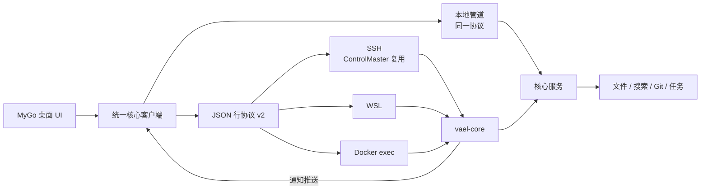

# Vael

基于 **Go + MyGo 原生 UI** 的桌面代码编辑器。布局参考 Lapce、Zed：左侧活动栏和项目侧栏、中央标签式编辑区、底部终端与状态栏。视觉配色参考 [GoShell](https://github.com/tk103331/goshell)。

## 启动

需要 Go 1.27.3 或更新版本、Git，以及 MyGo 支持的桌面环境。Go 可以自动下载项目声明的工具链。

```sh
go run . /path/to/project
```

注意是 `go run .`（编译整个包），不是 `go run main.go`——单文件模式看不到同包的其他源文件，会报 `undefined: newApp` 等错误。

不传路径时恢复上次的项目与布局；首次启动打开当前目录。应用内可通过“打开项目”切换本地文件夹，或通过“连接环境”连接 SSH、WSL、Docker，也可以把文件夹直接拖到窗口上。

```sh
go tool mygo dev
go tool mygo build
```

MyGo 终端使用 Ghostty 的 `libghostty-vt`；首次以 `go run` 启动终端会下载运行库，`mygo dev/build` 会准备运行库。

## 已实现

### 编辑

- 多文件标签页（参考 GoShell）：圆角标签、文件图标、未保存的圆点标记、悬停才显形的关闭按钮、悬停提示为文件完整路径；活动标签填充高亮，其余透明。右键菜单（关闭、关闭其他、关闭全部、在文件树中显示、复制路径），`⌘/Ctrl+Shift+]` 与 `[` 切换标签，标签栏右侧为查找／换行／保存。
- 语言语法高亮、行号、折叠、编辑器自带的查找替换、转到行、自动换行。
- 缩放：`⌘/Ctrl+=`、`-`、`0` 同时调整编辑器、差异视图与终端的字号，随会话保留。
- **Git 变更行标**：装订线按上一次提交标记新增、修改的行与被删除的位置，提交后自动更新；未跟踪文件不标记。
- 状态栏显示光标的行列位置。
- `F2` 重命名当前文件。
- 命令面板（`⌘/Ctrl+Shift+P`）：执行命令面板中列出的所有操作。
- 大纲：当前文件的函数、类型和类，随编辑实时更新，点击跳转到定义处。
- 项目符号搜索：跨项目查找函数、类型和类，支持跳转。
- 转到定义：光标处的符号在项目符号中查找并跳转（`⌘/Ctrl+点击` 或 F12）。
- 快速打开文件：支持文件名、路径子串和模糊匹配；结果列表支持 `↑↓` 键选、Enter 打开选中项、按类型徽标识别。
- 命令面板按使用频率排序，常用命令排在前。
- 文件树按 Git 状态着色：已修改琥珀色、未跟踪绿色（悬停提示），标签栏有全部标签页菜单。
- 项目全文搜索与**全部替换**：支持区分大小写、Unicode 文本、点击结果定位到匹配文本；替换经确认后执行，报告替换处数与文件数，随后刷新仓库状态与索引。搜索磁盘版本，遵循 Git 忽略规则；无仓库时跳过常见生成目录。

### 文件

- 文件树按需加载目录，文件夹显示展开箭头与文件夹图标，文件按类型显示徽标（GO、TS、PY…），右键菜单含打开、重命名、创建副本、删除、复制路径，支持筛选已加载文件、新建根目录文件和文件夹、手动刷新；名字过长时文件树可横向滚动。
- 文件树右键菜单：打开、重命名、创建副本、删除。删除和放弃更改都会先确认。
- 保存检查磁盘文件是否被其他程序修改；保留文件权限；关闭未保存文件、切换项目和退出时提示。
- 文件监听：磁盘上的文件被其他程序修改时自动重新载入；若编辑器中有未保存修改，则保留修改并提示重新载入或保留。

### Git

- 分支列表与切换、获取、拉取、推送；标题栏的分支切换器支持搜索、最近分支、本地与远程分支、新建分支、检出标签或修订，并显示上游与领先／落后提交数。
- 工作区和暂存区列表、暂存、取消暂存、放弃更改、提交（提交框按 Enter 即提交），以及分栏差异视图。变更行的 `+` / `−` 操作暂存，`↺` 放弃更改，`↗` 打开文件。活动栏的 Commit 图标显示变更数量徽标。
- 最近 20 条提交记录。
- **Git 日志**（参考 IDEA 的 Log，底部工具窗标题为「Git」）：左侧是分支面板（搜索、HEAD／本地／远程分组、可折叠、当前分支带星标，点选即筛选）；中间工具栏是带放大镜的搜索框（`.*` 切换正则、`Cc` 切换区分大小写）与「分支／作者／日期／路径」文本筛选（未设置时只显示名称），右侧是刷新、显示提交图、显示提交详情三个图标；提交按拓扑顺序读取，提交行按 IDEA 排布：参考 GoShell GitGraph 的提交图（车道固定不跳动，贯穿线、起止处的半截线、合并与回并的斜线连接（IDEA 式：斜线正好落在相邻提交的圆点上）、圆点，车道更窄、圆点更小、线条更细，颜色按车道区分）、提交信息（合并提交变灰）、带分支／标签图标的引用徽标、作者、右对齐的时间，当前分支所在行带蓝底；右侧列出所选提交更改的文件（按目录分组、目录可折叠、状态字母徽标、点击打开）与提交详情（短哈希与复制按钮、作者、时间、包含的分支、完整信息），两侧的分隔线可拖动；提交行可右键：复制哈希、复制提交信息、检出该提交、在此创建分支。引用徽标本地在前、远程在后，最多两个，其余显示 `+N`。`⌘/Ctrl+Shift+G` 打开，或点底部工具窗左侧竖条的 Git 图标。

### 任务与终端

- **Agent 面板**（右侧）：通过 **ACP（Agent Client Protocol）** 接入 Agent——选中一个 Agent 点 ▶，编辑器用它的启动命令拉起进程，经 stdin/stdout 行式 JSON-RPC 握手（`initialize`、`session/new`）并在当前项目里开会话；输入框发 `session/prompt`，回答、思考、工具调用按 `session/update` 流式显示。消息流：`agent_message_chunk` / `agent_thought_chunk` 连续分块合并、工具调用按 `toolCallId` 就地更新状态（进行中／已完成／失败）并显示输出与涉及的文件、`plan` 显示为「任务」清单（已完成数／总数，可折叠）、`current_mode_update` 与 `available_commands_update` 提示；`stopReason` 为 `input_required` 时提示补充、`refusal`／`cancelled` 分别提示。
- **工具审批**：Agent 发 `session/request_permission` 时面板按它给出的选项列出按钮（允许一次／总是允许／拒绝…），选择记入对话；选择「总是允许」后同类的工具请求自动放行并在对话中注明；请求按到达顺序排队，取消本轮会把未答复的请求一并回为取消。
- 可取消本轮（`session/cancel`）、新建会话或停止 Agent。
- **ACP Agent 的设置**（设置 → ACP Agent）：列出已接入的 Agent（名称、启动命令、默认项、移除）；「从 ACP Registry 添加…」提供 Gemini CLI、Claude Code、Qwen Code、Goose、Codex CLI 等起点命令；「手动添加…」填名称与任意启动命令。配置保存在 `agents.json`（与会话、连接配置同目录）。
- 任务面板（项目搜索、项目符号同）：在项目目录运行命令（`go build ./...`、`npm test` 等），**输出实时显示**（无论项目在本地还是云端），显示退出码和耗时，可随时停止，也可把命令**发送到已打开的终端**；输出只保留末尾 128 KiB；保留最近运行过的命令。
- 在项目目录启动真实 PTY shell，支持多个终端会话；远程环境中终端直接进入目标目录。

### 窗口

- **自绘标题栏**：窗口无系统边框，标题栏由应用绘制——macOS 为红黄绿三枚交通灯（关闭／最小化／最大化），Windows 与 Linux 为最小化／最大化／关闭按钮（关闭按钮悬停变红）；标题栏空白处与标志可拖动窗口。
- 标题栏同时承载快速打开、打开项目、工作环境、连接环境、侧栏、终端、设置与主题切换（均为图标按钮）。macOS 窗口圆角 10 DIP。
- **环境切换器**（标题栏，在项目之前）：地球图标与当前环境（未连接时显示「连接环境」）；下拉列出已保存的环境（图标、名称、SSH／WSL／Docker 与目标），另有「连接新环境…」与「管理工作环境…」。
- **项目切换器**（标题栏）：项目徽标（按 `go.mod`、`package.json`、`Cargo.toml` 等识别语言）、项目名与下拉箭头；菜单含新建项目、打开、克隆仓库、当前项目、最近项目与管理工作环境，路径与徽标一并显示。
- **分支切换器**（标题栏，参考 Zed）：搜索框、更新项目／提交／推送、新建分支、检出标签或修订，以及“最近／本地／远程”分组（本地与远程可折叠，搜索时自动展开）；当前分支带星标、上游名与领先／落后提交数。

### 工作区

- **面板抽象**（`panel.go`）：每个工具窗是一个值——图标、名称、悬停提示、标题、默认位置（left／right／bottom）、可选的标题栏与徽标、视图函数；三条图标条、左右外壳与底部外壳都从这张表里读，新增面板只需加一条。项目搜索、项目符号、任务为隐藏面板，只由命令面板打开。
- **IDEA 式四区布局**：左侧活动栏与工具窗（**文件**、**Commit** 两个面板）、中间编辑区、右侧面板（**大纲**、**Agent**，图标条在最右侧）、底部工具窗（**终端**与 **Git 日志**，只在左右两侧面板之间，不伸到侧栏或右侧面板下面）、底部状态栏；各分隔线均可拖动调整大小。底部工具窗左侧有自己的竖排切换条（终端／日志图标，通高），标题栏只显示当前面板，日志默认占约一半高度。
- **面包屑**：标签栏下方显示当前文件的路径，点击任一段在文件树中定位。
- **状态栏**：连接状态、Git 分支与变更数、文件路径、行列位置与选中字符数、保存状态、编码、**缩进**（空格宽度或制表符，点击可转换）、**行尾符**（LF／CRLF，点击可切换）、语言。
- **最近文件**（`⌘/Ctrl+E`）：按最近打开顺序列出项目中的文件，可输入筛选，Enter 打开。
- **专注模式**（`⌘/Ctrl+Shift+F12`）：隐藏活动栏、所有工具窗、面包屑与状态栏，只留标题栏与编辑器。
- 左侧活动栏切换文件树与 Commit（提交图标即「提交」的 git-commit 符号，变更数显示为徽标）；右侧图标条（在窗口最右）切换大纲与 Agent，再次点击收起；底部工具窗只由它自己的左侧竖条切换终端与日志。项目搜索、项目符号、任务面板仍可从命令面板打开。终端标题栏依次是「终端」、会话标签、`+`、`⌄`：选中会话带下划线，悬停或选中时显示关闭按钮，`+` 新建会话，`⌄` 列出全部会话。
- 工具栏以图标按钮为主（悬停显示提示）：快速打开、打开项目、**侧栏**、**底部面板**、**结构面板**（三者开启时图标高亮，与切换侧栏的按钮同一套图标语言）、**设置**、主题、新建文件/目录、刷新、查找、换行、保存、获取/拉取/推送、任务运行/停止/发送到终端等。
- **设置面板**：四个分栏，改动即生效并随会话保留。
  - **外观**：明暗主题、字号（9–24，`-` / `+`）、行高（紧凑／标准／宽松）。
  - **编辑器**：自动换行、Tab 宽度（跟随语言／2／4／8）、缩进（跟随语言／空格／制表符）、显示空白（选中时／从不／总是／行尾）、缩进参考线、自动闭合括号、行号；这些都写进每个标签页的编辑器状态，改完立即生效。
  - **环境**：远程环境管理——已保存的环境（名称、SSH／WSL／Docker 与目标、根目录，可编辑或移除）、新建连接、收藏当前环境、最近项目与清空。标题栏环境下拉的「管理工作环境…」、命令面板与项目菜单都指向这里。
  - **ACP Agent**：Agent 列表（名称、启动命令、默认项、移除）、从 ACP Registry 添加、手动添加。
- **新建项目**：输入名称并选择位置，创建文件夹后直接打开；**克隆仓库**：输入仓库地址与位置，克隆完成后自动打开。两者都经核心执行：连接远程环境时，文件夹或克隆在目标环境里创建，随后编辑器自动重连到新根目录；只有本地项目才显示原生文件夹选择器。
- **文件拖放**：把文件夹拖到窗口即打开为项目，把文件拖到窗口即在编辑器中打开；连接远程环境时会说明本机文件无法在那里打开。
- 终端选中即复制到剪贴板（Ghostty 的 copy-on-select）。
- 编辑器右键菜单：复制路径、在文件树中显示、重命名。
- 任务运行时状态栏显示指示，点击前往任务面板。
- 明暗主题。
- 退出后恢复环境配置、文件标签、光标位置、主题和面板尺寸。文件从磁盘重新读取，不恢复已丢弃的未保存内容或终端进程。
- 命名保存 SSH、WSL、Docker 连接配置，收藏本地项目，管理配置与最近 20 个项目。
- 状态栏显示连接状态，支持取消连接与手动重连。重连仅替换核心通道，保留编辑缓冲区、未保存修改、光标位置和已有终端；文件保存仍检查磁盘修改冲突。

## UI 与核心两层架构



### 协议（参考 Lapce 的 proxy 协议）

每条消息是一行 JSON，带消息类型：

| 类型 | 用途 |
| --- | --- |
| `request` | 客户端请求，带自增编号 |
| `response` | 结果，带请求编号 |
| `error` | 结构化错误，带请求编号和错误码 |
| `notification` | 核心主动推送（文件变更、任务输出），带订阅编号 |
| `cancel` | 取消一个在途请求或订阅 |

握手先核对协议版本与**能力特性**（`watch`、`stream.run`、`replace`、`symbols`、`clone`）；任一缺失即拒绝连接并提示重新连接以自动上传新核心——远端核心不会因版本号相同而被旧实现静默顶替。错误带码（404 文件不存在、409 保存冲突、413 过大、415 非文本、408 超时、403 权限），UI 可据此处理而不是只显示文本。

**本地与远程同一条协议**：本地核心同样以协议 v2 通过一对内存管道运行，而不是进程内直调。这样本地与远程的并发、取消、错误码和推送行为完全一致，也覆盖了此前本地直调与流式连接行为不一致的问题。

**推送代替轮询**：文件监听改为订阅——UI 发出 `watch`，核心建立订阅并持续推送 `changed` 通知，编辑器不再发长轮询请求占用连接槽位。任务同理：`run` 立即返回订阅编号，输出按行推送（`output`），结束时推送 `done`（退出码与耗时）；客户端取消上下文或发送 `unwatch` 时，核心终止命令。核心在收到 `cancel` 或断开时结束订阅。

UI 负责展示与交互，项目文件、搜索、Git 与克隆操作统一经过 `internal/core.Client`。核心无 MyGo 依赖，可在没有图形环境的云服务器、WSL 或容器中独立运行。连接关闭时取消核心中的请求；Git 操作有超时限制。

终端采用独立通道：UI 用 MyGo 的 PTY 终端组件运行对应环境的交互命令（`ssh -tt`、`docker exec -it` 或 `wsl.exe`），shell 在目标项目目录运行。SSH 的 RPC 通道与终端通道共用一条 ControlMaster 连接，只需一次握手。当前核心以连接为生命周期，断开后不保留远程终端会话。

## SSH / WSL / Docker

参考 Lapce 的做法，连接 SSH 时会**自动准备远程核心**：

1. 用 `uname -s`、`uname -m` 询问目标平台的系统与架构；
2. 检查远端核心版本（`vael-core --version`）；
3. 不匹配时，把编辑器旁的 `vael-core`（通过 ssh 管道直接传输）上传到 `$HOME/.local/share/vael/core/vael-core` 并 `chmod +x`；
4. 校验能运行后再启动 `--stdio` 通道。

因此大多数情况下**无需手动在服务器安装核心**——把 `vael-core` 与编辑器可执行文件放在同一目录即可。仍然可以手动安装并在“核心程序路径”填写自定义路径（`~/` 开头的路径会按远端 `$HOME` 展开），或留空使用默认安装位置。

### 真实环境验证

`internal/core/ssh_live_test.go` 是对真实主机的验收测试，只在设置环境变量时运行：

```sh
VAEL_SSH_HOST=ubuntu@host go test -count=1 -v -run TestSSHCloudMode ./internal/core/
```

它完整走一遍云端流程：探测平台 → 上传并校验核心 → 协议握手 → 远端文件的建/读/写/列表 → 带退出码的命令执行 → 文件变更推送（订阅）→ PTY 终端命令，最后清理验证项目。已在 `ubuntu@82.156.132.143`（Linux x86_64）通过。验证会在远端留下已安装的核心（这是产品的安装位置），并删除临时项目目录。

Docker 模式用同样的门控验证，测试会自建临时容器、按说明装入核心、走完整流程（握手、文件、命令、推送、容器内 shell），结束时删除容器：

```sh
VAEL_DOCKER=1 go test -count=1 -v -run TestDockerCloudMode ./internal/core/
```

已在本地 OrbStack（linux/arm64，`debian:stable-slim`）通过。容器需已安装核心并保持运行；`docker exec` 不经 shell，核心由容器内 `/bin/sh -c` 启动，路径中的 `$HOME`、`~` 在容器内展开。`docker exec -it` 不接受管道 stdin，编辑器的真实终端不受影响；测试用容器内 `script` 分配伪终端代替验证。

核心只使用 Go 标准库，可从其他平台交叉编译，例如：

```sh
GOOS=linux GOARCH=amd64 go build -o dist/vael-core-linux-amd64 ./cmd/vael-core
GOOS=linux GOARCH=arm64 go build -o dist/vael-core-linux-arm64 ./cmd/vael-core
```

将跨平台编译的核心放入目标环境（WSL 与 Docker 需手动安装，SSH 会自动上传）。然后在 UI 的“连接环境”对话框中选择方式并填写目标、项目绝对路径，核心程序路径留空即可。

| 方式 | 目标示例 | 前提 |
| --- | --- | --- |
| SSH | `devbox` 或 `user@server` | 本机 OpenSSH 可用，SSH 配置与密钥代理已就绪，首次主机验证已在终端完成；核心由编辑器自动上传 |
| WSL | `Ubuntu`，或留空使用默认发行版 | UI 运行在 Windows，`wsl.exe` 可用，核心安装在发行版内部 |
| Docker | `dev-container` 或容器 ID | 本机 Docker CLI 当前上下文可用，容器已运行，核心安装在容器内部 |

SSH 端口可在对话框中填写，或由 `~/.ssh/config` 中的别名提供。SSH 通道使用 `ControlMaster=auto`、`ControlPersist=30m` 复用连接，因此核心通道与终端通道只需一次握手，与 Lapce 的远端模式一致。

核心按目标环境用户的权限访问文件，项目路径应填写该环境中的 Unix 绝对路径。WSL 与 Docker 的交互终端默认运行 `/bin/sh -l`，目标环境需提供该 shell。

配置只保存环境类型、目标名称、端口、项目路径和核心命令，不保存密码。SSH 连接要求密钥或系统 SSH 代理可用（`BatchMode` 语义，无交互密码输入）。应用不会自动安装或上传核心到 WSL 和 Docker。

点击顶部“工作环境”打开配置与最近项目列表。在连接对话框中输入配置名称并选择“保存连接配置”，同名保存会更新已有配置；也可收藏当前本地或远程项目。移除配置和清空最近记录不会删除项目文件。配置写入系统用户配置目录中的 `vael/environments.json`，退出会话保存在同目录的 `session.json`。

核心通道断开时，状态栏显示“连接已断开”，悬停可查看原因，并**自动重连**（间隔 1s、2s、4s…上限 30s，可随时“停止重连”，切换项目即放弃）。也可点击“重新连接”立即手动重连，或通过“文件 → 重新连接当前环境”。断开后仍可编辑已打开的缓冲区，重连成功后可继续保存。如果磁盘文件在断开期间已变化，保存会提示冲突。重连仅替换核心通道，保留编辑缓冲区、未保存修改、光标位置和已有终端；不重建或复活已结束的终端进程。

连接过程中可以取消或切换到其他项目；旧连接的迟到结果会被忽略。退出会关闭当前核心通道并取消未完成的连接请求。

## 快捷键

| 功能 | macOS | Windows / Linux |
| --- | --- | --- |
| 打开项目 | ⌘O | Ctrl+O |
| 连接工作环境 | ⌘Shift+O | Ctrl+Shift+O |
| 命令面板 | ⌘Shift+P | Ctrl+Shift+P |
| 快速打开文件 | ⌘P | Ctrl+P |
| 项目全文搜索 | ⌘Shift+F | Ctrl+Shift+F |
| 转到行 | ⌘G | Ctrl+G |
| 转到定义 | ⌘点击 / F12 | Ctrl+点击 / F12 |
| 新建文件 | ⌘N | Ctrl+N |
| 保存 | ⌘S | Ctrl+S |
| 关闭文件 | ⌘W | Ctrl+W |
| 查找替换 | ⌘F | Ctrl+F |
| 切换侧栏 | ⌘B | Ctrl+B |
| 显示终端 | Ctrl+` | Ctrl+` |
| 新建终端 | Ctrl+Shift+` | Ctrl+Shift+` |
| 自动换行 | Alt+Z | Alt+Z |
| 放大 / 缩小 / 重置 | ⌘= / ⌘- / ⌘0 | Ctrl+= / Ctrl+- / Ctrl+0 |
| 下一个 / 上一个标签页 | ⌘Shift+] / ⌘Shift+[ | Ctrl+Shift+] / Ctrl+Shift+[ |

这是初始版本：尚未集成 LSP、调试器、插件系统、自动重连和远程终端会话的恢复。文件仅支持 UTF-8 文本，大小上限为 8 MiB；索引最多 100000 个文件，全文搜索最多读取 64 MiB 文本、返回 500 处匹配，项目符号最多 4000 个。Git、文件树及快速打开索引可通过刷新按钮更新；保存及 Git 操作后刷新仓库状态。切换项目会结束原项目终端。符号识别基于各语言声明的常见写法，不是完整的语法分析：Go、JavaScript、TypeScript、Python、Rust、Java、C、C++、Ruby、Shell 和 Lua 的函数、类型与类可被识别。

## 开发验证

```sh
go test ./...
go test -race ./...
go vet ./...
go build .
go build -o vael-core ./cmd/vael-core
```

代码按桌面 UI（根目录）、无界面核心服务与连接协议（`internal/core`：`protocol.go` 消息与错误码、`server.go` 服务端、`stream.go` 客户端、`watch.go` 订阅、`client.go` 类型化调用、`connection.go` SSH/WSL/Docker）、文件与 Git 实现（`internal/workspace`）、核心可执行入口（`cmd/vael-core`）组织。`connection.go` 和 `navigation.go` 分别负责 UI 的环境连接与导航交互，`watcher.go` 负责文件监听，`symbols.go`、`tasks.go` 和 `git.go` 分别是符号、任务与 Git 的界面逻辑。

测试覆盖本地与流式核心调用的一致性（同一协议）、独立进程通信、并发请求、订阅推送与订阅生命周期、任务输出的实时流式推送与中途停止、断线自动重连（重试、停止、项目切换后放弃）、断开通知、重连保留编辑状态、重连后保存冲突、取消及迟到回包处理、结构化错误码、环境配置持久化、连接命令与端口传递、主机探测路径、路径引用（`$HOME` 展开与单引号转义）、保存权限、Git 暂存与放弃操作、分支与提交读取、忽略规则、Unicode 搜索偏移、文件重命名/复制/删除、文件监听的重新载入与冲突提示、命令面板匹配、项目符号与大纲、任务运行与退出码，以及 UI 布局切换。SSH 云端模式的探测、上传、握手、文件操作、命令执行、变更推送与 PTY 终端已在真实主机（`ubuntu@82.156.132.143`，含流式任务的推送与远端核心的能力校验、自动重传）与本地 OrbStack 容器（linux/arm64）验收；WSL 的实际连接还需在对应运行环境中验收。文件拖放与设置面板以界面测试覆盖（拖放通过状态注入验证，实际 Finder 拖放待在桌面会话中确认）。

## 致谢

[MyGo](https://github.com/egoist/mygo) 提供 UI、代码编辑器、差异视图和 Ghostty 终端组件。GoShell 的颜色和界面组织为本项目提供参考，相关 MIT 声明保留在 `THIRD_PARTY_NOTICES.md`。
